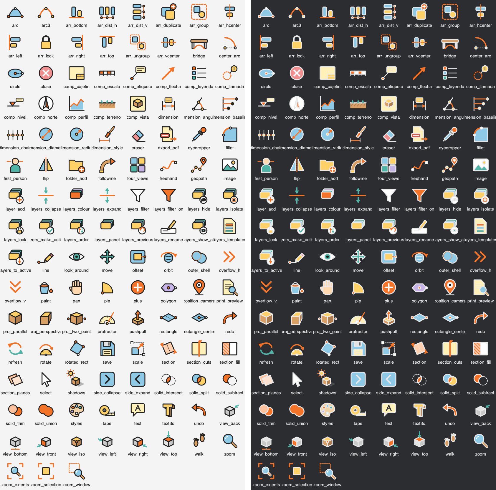
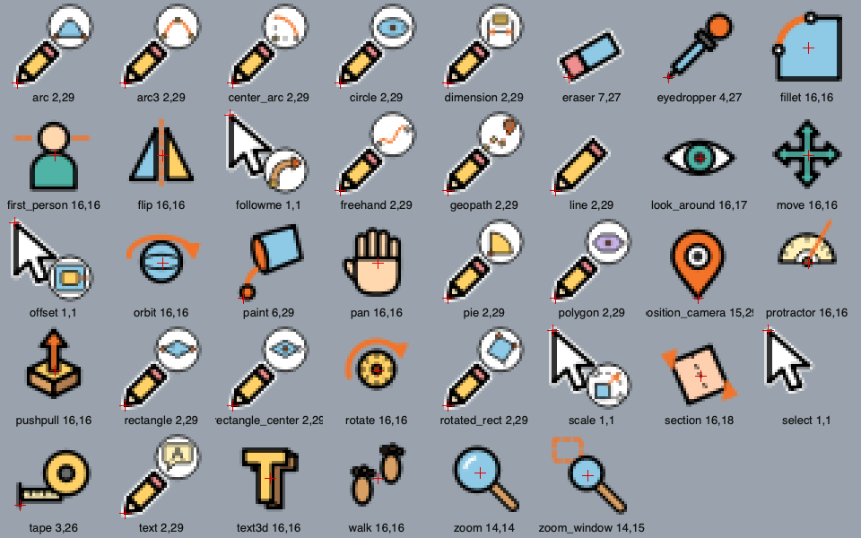

# Workshop Color — an icon theme for IngeTrazo

A colour icon theme for [IngeTrazo](https://github.com/ingelibre/ingetrazo):
every toolbar icon and every 3D view cursor, with bold outlines, flat colour
fills and IngeTrazo's orange accent.

It is a theme for the
[Custom Icons](https://github.com/APBureauEtude/ingetrazo-custom-icons)
extension: **123 icons** and **40 cursors**, with their `mapping.json`.

> **AI-generated.** These icons were generated with an AI assistant, as SVG
> code, then reviewed by me in IngeTrazo. They are original drawings, not
> copied or traced from any other program's icons.

## Icons

Light and dark interface:

## Cursors

The red cross marks where each cursor clicks: the pencil's tip for the
drawing tools, the arrow's point for Select, Scale, Offset and Follow Me, the
drop for Paint, and the same spot as IngeTrazo's own cursor for the others
(the centre of the move cross, the magnifier's lens, the marker's tip…).
In guide mode, the Tape Measure and the Protractor show a small «+».

## Install

1. Install the [Custom Icons](https://github.com/APBureauEtude/ingetrazo-custom-icons)
   extension (version 1.1 or later) and start IngeTrazo once.
2. Copy the `Workshop Color` folder into the extension's `Icônes custom`
   folder (**Extensions ▸ Custom icons ▸ Open icons folder**).
3. **Extensions ▸ Custom icons ▸ Choose icons…**, then pick **Workshop Color**
   at the top of the page.

It shows at once, with no restart.

## Notes

- The outlines use `currentColor`, so they follow IngeTrazo's light and dark
  themes. The fills keep their colours.
- Each file is named after IngeTrazo's own key (`icons/line.svg`,
  `cursors/line.svg`), so **Match by file name** pairs the whole theme too.
- Made and tested with IngeTrazo 0.6.1 on macOS.

## Licence

[GPL-3.0](LICENSE), like IngeTrazo and the Custom Icons extension.
